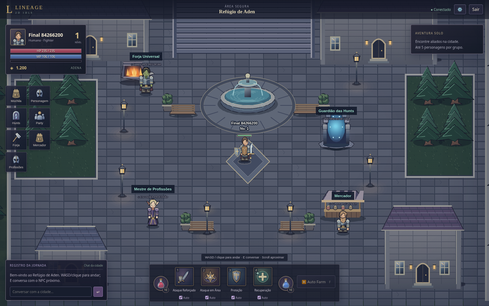

# Lineage 2D Idle — versão jogável 0.1.0

Primeiro marco de um RPG idle multiplayer para navegador. A implementação está nesta pasta independente; GAME-1/GAME-2 não foram modificados. A especificação original está integralmente em [PROMPT_MESTRE_CODEX_LINEAGE_2D_IDLE.md](PROMPT_MESTRE_CODEX_LINEAGE_2D_IDLE.md).

**Esta é uma adaptação no nosso jogo**, com o cenário importado e a interface aproximada da referência. Os personagens, servidor, contas, farm, skills e economia continuam sendo os nossos; o ZIP do site não trouxe o backend nem todos os sistemas/arquivos necessários para um clone completo.



## Baixar pelo GitHub

[Baixar ZIP desta versão](https://github.com/rodrigobrito020-gif/GAME-1/archive/refs/heads/lineage-2d-idle.zip) · [Ver código](https://github.com/rodrigobrito020-gif/GAME-1/tree/lineage-2d-idle)

Esta versão usa a branch exclusiva `lineage-2d-idle` do GAME-1. A branch principal do RPG 3D permanece preservada. O ZIP contém este jogo; extraia e abra o terminal na pasta que contém `package.json`.

## Testar a praça do ZIP enviado

**Teste 2:** HUD compacto no alto à esquerda, menus no alto à direita, chat embaixo à esquerda, quatro skills no centro e Auto Farm separado à direita. O iniciador anuncia `TESTE 2` e recusa iniciar se uma versão antiga ainda estiver usando as portas. Feche o terminal anterior com Ctrl+C antes de abrir `INICIAR_TESTE.bat`. O Vite não muda mais silenciosamente para outra porta.

Está disponível a [versão de teste da praça importada](docs/TESTE_DA_PRACA.md), com nossas regras, personagens e serviços. Mantenha seu `recursos-publicos.zip` em Downloads ou na pasta do jogo e abra **`INICIAR_TESTE.bat`**. Depois abra **http://localhost:5173** quando o terminal estiver pronto. Para atualizar mantendo o progresso, mescle os arquivos de código novos na instalação anterior com o servidor parado; preserve `.env` e `prisma/dev.db`.

O ZIP de recursos é importado localmente; o download do GitHub contém o importador e nosso código. Sem o pacote local, o jogo continua usando a cidade anterior. Esta atualização de teste modifica cliente, servidor e configuração compartilhada: **copiar somente `apps/client` não basta para ela**. Os personagens atuais permanecem até criarmos os assets próprios.

## Atualização visual — 30/10/2026

A praça agora usa pedra em tons de ardósia, escadaria, jardins, iluminação, fonte animada e serviços visualmente distintos. Os personagens têm proporções, armaduras, cabelo e poses de frente/costas/perfil; criaturas e summons usam desenhos próprios. Retratos e ícones de equipamentos/habilidades substituem letras e símbolos genéricos. HUD/chat foram compactados; o scroll aproxima/afasta a câmera. A arte continua original e local, sem carregar imagens do jogo usado como referência.

**Para atualizar uma instalação existente sem alterar seu personagem:** pare o jogo com Ctrl+C, extraia o ZIP novo em outra pasta e mescle os arquivos de código novos na instalação anterior. Preserve `.env` e `prisma/dev.db`. Siga o [procedimento da praça de teste](docs/TESTE_DA_PRACA.md) para a versão atual; ela inclui a integração no servidor. Se usar a versão compilada, rode `npm run build` antes de `npm start`.

Detalhes e limites em [docs/ATUALIZACAO_VISUAL.md](docs/ATUALIZACAO_VISUAL.md).

## Executar no Windows

Instale **Node.js 22.12+ ou 24 LTS**. Abra PowerShell ou CMD na pasta extraída que contém `package.json`. Na primeira execução:

```powershell
npm install
```

Copie `.env.example` para `.env` (somente se ainda não existir):

```powershell
Copy-Item .env.example .env
```

No CMD, use `copy .env.example .env`. Depois:

```powershell
npm run setup
npm run dev
```

Abra **http://localhost:5173**. `setup` gera o Prisma Client, aplica a migration SQLite e verifica o banco, sem apagar personagens. Crie nome/senha na tela inicial e escolha raça e Fighter/Mystic; Anões só têm Fighter. Para carregar, use **Continuar jornada** ou a sessão lembrada no navegador.

Se o PowerShell bloquear `npm.ps1`, use `npm.cmd` nos mesmos comandos; não é necessário alterar a política de execução.

### Executar a compilação local

```powershell
npm run build
npm start
```

Abra **http://localhost:3001**. `npm start` desliga DEV no processo, mesmo que `.env` tenha `DEV_MODE=true`. Encerre com Ctrl+C. Não execute o servidor de desenvolvimento e a compilação na mesma porta ao mesmo tempo.

O banco fica em `prisma/dev.db`; preserve esse arquivo para manter os personagens. `DATABASE_URL=file:./outro.db` usa outro banco na pasta `prisma`; aplique `npm run setup` nele antes de iniciar. Fazer backup do SQLite e de seus arquivos auxiliares com o servidor parado evita uma cópia incompleta.

**Não é um HTML para abrir com dois cliques:** o servidor faz parte do jogo. Para amigos em outros computadores, todos precisam acessar o mesmo servidor. A versão local não configura domínio, HTTPS ou hospedagem pública automaticamente.

## O que já é jogável

- Criação/login de personagens persistentes, sessão autenticada e reconexão. Senhas usam scrypt com salt; o cliente não envia personagens, moedas ou recompensas prontas ao servidor.
- Cidade social única, com vários personagens conectados, chat real, WASD/setas e clique para caminhar, colisão nas construções e câmera acompanhando.
- NPCs de hunts, profissões, mercador e forja. Clique no NPC ou use E perto dele. Os painéis possuem um botão para caminhar até o serviço; o servidor valida a proximidade.
- Exatamente **12 faixas, 18 hunts e 24 espécies provisórias**. Até 150, hunts físicas/mágicas separadas; depois, duas espécies na mesma hunt mista. Entrada exige nível **e** precisão; poder é só recomendação.
- Solo em instância privada. Party real de até cinco entra numa instância exclusiva do grupo. Há cinco pontos de respawn; cada ponto cria um monstro por participante. Auto Farm procura alvos, anda entre pontos, combate, usa MP/cooldowns, consome poções e concede EXP/SP/Adena/loot pelo servidor.
- Os **25 kits de primeira profissão** e os dois kits iniciais seguem os nomes aprovados e têm efeitos ativos: ataques, formas de AoE, mitigação, esquiva, stun, debuffs, DoT, cura, regeneração, vampirismo e buffs de Party. Os quatro slots são fixos; a troca de arma autorizada muda o kit.
- Dwarf Fighter: Ataque Reforçado, Summon, Spoil, Sweeper. Scavenger perde summon, marca até dois inimigos vivos e coleta cadáveres com Sweeper. Artisan perde Spoil/Sweeper e invoca até dois; Warsmith/Maestro até três. Summons seguem o mestre, copiam seu alvo, combatem e podem receber dano/proteção. Invocar/coletar exige skill, MP e cooldown.
- Party: convite/aceite, líder, assistência ao alvo do líder e três distribuições de loot. Cinco personagens recebem +20% de EXP total antes da divisão e +10% **relativo** na chance de drop comum; não há bônus de drop de Boss. Cada monstro processa sua tabela uma vez; summons não recebem parcela de EXP nem duplicam loot.
- Inventário em grade, detalhes, equipar/retirar, troca visual da arma/peitoral e escudo equipado. Itens equipados saem da mochila; armas incompatíveis e grades acima do nível são recusadas. Trocar profissão não concede equipamento gratuito.
- Mercador vende poções/armas No Grade e compra itens da mochila. Craft de armas é universal e consome materiais reais. Grades B/A/S usam minérios das hunts avançadas. Reforja de uma linha de ataque usa os pesos aprovados de +1 a +10.
- Bosses **experimentais** nos marcos 225/250/275/300: botão na hunt correspondente, luta, morte e loot autoritativos. Sailren é o nome aprovado no 300; os outros marcos usam placeholders. Não são encontros definitivos aprovados.
- Animação procedural de caminhada, ataque/cast, hit e morte; projéteis, números de dano, HP de unidades, quatro skills com cooldown, métricas EXP/h e loot/h, logs e poções configuráveis.
- Níveis continuam além de 300, com fator 0,5x na EXP pessoal a partir daí.

## Controles e percurso sugerido

1. Crie um personagem. Use WASD, setas ou clique no chão da cidade.
2. Clique no portal ou abra **Hunts** e use **Caminhar até o NPC**. Entre em 1–25. O scroll do mouse ajusta o zoom da câmera.
3. Auto Farm começa ativo; **F** pausa/retoma. Clique num monstro para trocar o alvo. **1–4** ativam as quatro skills, e seus checkboxes controlam o uso automático.
4. Use **Retornar à cidade** para voltar. **I** abre a mochila; um duplo clique equipa itens na cidade. Selecione um item para retirar do slot. Visite o mercador para suprimentos e vendas.
5. No nível 50, visite o Mestre de Profissões. Compre/fabrique ou obtenha uma arma permitida pelo novo caminho. Equipamentos incompatíveis voltam à mochila, com validação de espaço.
6. **Configurações** permite definir percentuais de poções de HP/MP. Zero desliga o automático.
7. Para testar Party localmente, use outro navegador ou um contexto anônimo independente e crie outro personagem. Convide pelo painel **Party** e aceite no outro cliente. Todos devem estar na cidade; o líder escolhe a hunt. A composição só muda quando todos estão na cidade.

Ao pausar Auto Farm, o personagem deixa de procurar alvos/andar/usar skills automaticamente. Os summons continuam assistindo o alvo inimigo selecionado do mestre, conforme a regra aprovada.

## Testar conteúdo avançado sem grind

Em `npm run dev`, com `DEV_MODE=true`, o botão **DEV · Testar conteúdo** permite escolher nível (1–1000 somente nesta ferramenta), primeira profissão, arma e especialização já mapeada. Adiciona Adena/materiais de demonstração, claramente identificados; não são recompensas normais. Exemplo: nível 151, Artisan, Martelo e Warsmith para testar três summons. Para o anão inicial, escolha classe inicial, raça Anão e nível 1.

O nível 1000 é limite do formulário DEV, não da progressão normal. `NODE_ENV=production` ou `DEV_MODE=false` bloqueiam o comando no servidor; esconder um botão não é a proteção.

## O que ainda depende da aprovação do dono

A lista detalhada está em [docs/APROVACOES_PENDENTES.md](docs/APROVACOES_PENDENTES.md).

- Kits e nomes definitivos de segunda/terceira profissão, talentos e eventuais híbridos. Nenhuma árvore de passivas antes de 150, nem híbrido não aprovado, foi criado.
- Para testar níveis 150+, os kits anteriores são mantidos como **PROVISÓRIOS**, com exceções aprovadas: Festival do Bounty Hunter e limite de três summons do Warsmith/Maestro. Overlord/Warcryer reservam três slots bloqueados de debuffs/pacotes, sem inventar nomes/efeitos definitivos.
- Precisão mínima, fórmulas/estatísticas, custos, tempos, monstros/mapas reais e tabelas definitivas de drops/receitas/raridade de craft.
- Ordem/atributos dos três summons temáticos e encontros definitivos de Boss. Pterosaur e Tyrannosaurus estão registrados como Bosses; sua colocação não foi inventada.

Nomes/fluxos já aprovados são preservados. Valores provisórios estão centralizados em `packages/shared/src/config.ts`, `skills.ts`, `drops.ts` e nas fórmulas testáveis de `rules.ts`; a interface mostra o aviso de teste. Não se afirma equivalência de números com datapacks oficiais Interlude.

## Ainda não implementado neste marco

Talentos funcionais; kits definitivos 150+/300; híbridos; economia/receitas finais; craft de armaduras completo; encantamento, reparo, desmonte, mercado/trocas entre jogadores; recuperação de conta; recompensas offline e infraestrutura pública/escala de MMORPG. Esses sistemas não possuem botões fingindo executar uma operação.

A aparência é pixel art original/procedural de teste. Algumas armaduras usam apenas variação de cores representativa. Não foram extraídos sprites proprietários. O primeiro marco é jogável, mas o acabamento e os encontros avançados continuam em desenvolvimento.

## Arquitetura e manutenção

Etapas deste primeiro marco: (1) workspace, dados e banco; (2) criação/cidade/hunts e loop de combate; (3) classes, summons, Spoil e Party; (4) inventário, economia e forja; (5) testes de regras/rede/navegador, compilação executável e inspeção visual. As expansões que dependem de design estão separadas em `docs/APROVACOES_PENDENTES.md`.

- `apps/client`: React/Vite para HUD/painéis e Phaser 3 para mundo, câmera, personagens e efeitos. `art.ts` gera a arte local uma vez por textura; `icons.tsx` contém os ícones originais e `visual.css` o acabamento da interface. Pooling de efeitos limita somente a apresentação, não os combatentes.
- `apps/server/src/engine.ts`: simulação autoritativa de cidade, instâncias, combate, Party e comandos; sem regras de negócio nos componentes visuais.
- `apps/server/src/index.ts`: HTTP, autenticação, Socket.IO, limites de mensagens, snapshots e gravações serializadas.
- `apps/server/src/db.ts`: limite de acesso ao banco. Para PostgreSQL, trocar adapter/provider e migrations aqui; alterar só a URL não basta.
- `packages/shared`: tipos, configuração aprovada/provisória, kits, fórmulas e tabelas de drop por espécie.
- `prisma`: schema/migration versionada e seed idempotente. Prisma 6.19 usa o motor JS e o adapter oficial libSQL para SQLite local. Não requer Turso nem serviço remoto. O adapter de migration está explicitamente habilitado na configuração fixada; não há bypass de integridade/TLS.
- `tests`: regras, rede real e navegador. `npm run setup` prepara o banco; os testes de rede usam um SQLite temporário separado e o removem.

## Verificar o projeto

```powershell
npm run typecheck
npm run lint
npm test
npm run build
npm run test:browser
```

Os testes de navegador usam Chromium instalado. Neste ambiente: `/usr/bin/chromium`. No Windows PowerShell, ajuste para Chrome/Chromium existente:

```powershell
$env:CHROMIUM_PATH = "C:\Program Files\Google\Chrome\Application\chrome.exe"
npm run test:browser
```

Ou instale o Chromium do Playwright e configure o executável apropriado. Os testes do navegador iniciam o servidor se necessário. Resultados e limites da verificação estão em [docs/VALIDACAO.md](docs/VALIDACAO.md). Os comandos foram executados em Linux/Node 24; uma instalação física no Windows não foi executada neste ambiente.
