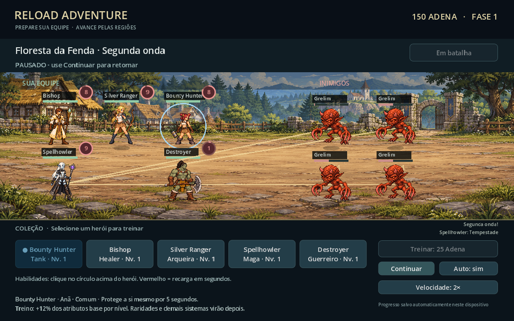

# Reload Adventure

Protótipo de RPG em equipe no **Godot 4.6.3**, com personagens provisórios.

## Baixar e jogar

1. Clique em **Code → Download ZIP** neste repositório.
2. Extraia o ZIP no computador.
3. Abra o Godot e clique em **Importar**.
4. Selecione **godot/project.godot** na pasta extraída.
5. Abra o projeto e pressione **F5**.

## Primeira versão

- Cinco heróis em seis posições, com formação por arraste.
- Primeiras artes de Bounty Hunter, Bishop, Silver Ranger, Spellhowler e Destroyer, adaptadas das referências do projeto.
- Movimentos básicos de repouso, ataque e dano; animações quadro a quadro ainda pendentes.
- Combate automático e habilidades manuais com recarga.
- Três ondas de Grelims adaptados da referência visual e um chefe maior por fase.
- Cenário de vila medieval junto à floresta, com chão em perspectiva.
- Treino com Adena e progresso salvo localmente.

A arte é provisória. História, raridades, equipamentos e demais sistemas do conceito ainda serão implementados.

Consulte [as instruções do projeto Godot](godot/README.md) para controles, testes e detalhes técnicos.

## Primeiros heróis no jogo

