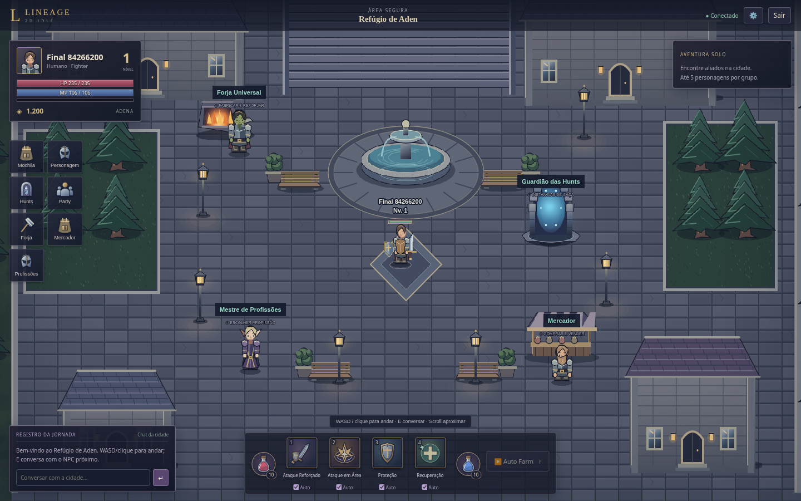

# Primeiro passe de arte — 30/10/2026

Este documento descreve o passe visual anterior. Para a versão atual com importação da praça, use [TESTE_DA_PRACA.md](TESTE_DA_PRACA.md): a atualização atual também inclui arquivos de servidor e configuração compartilhada.

O passe atende à comparação visual enviada pelo dono: cidade de pedra em tons frios, personagens com proporções mais próximas de um RPG 2D, detalhes medievais e interface discreta. A referência orienta a direção de arte; nenhuma imagem, sprite ou interface proprietária foi extraída dela.

## O que mudou

- Praça em ardósia com variações nos blocos, escadaria, fonte com água/ripples, bancos, canteiros e postes com iluminação suave. Serviços mantêm as coordenadas conhecidas pelo servidor.
- Personagens com silhuetas diferentes por raça e Fighter/Mystic, cabelo, rosto, pescoço, braços, ombreiras, capa, botas e armadura. Poses de frente, costas e perfil com caminhada; armas/escudos continuam representando equipamento real.
- Desenhos de criaturas físicas/mágicas e três variações visuais ao longo das faixas; IDs, nomes e atributos continuam provisórios. Summons usam modelos mecânicos distintos, respeitando os limites e as regras anteriores.
- Florestas, rochas e ruínas nas hunts, com variações visuais por faixa. O mapa de spawns e a simulação de farm permanecem iguais.
- Retratos derivados dos mesmos desenhos; ícones SVG originais para armas, escudos, roupas, poções, materiais e skills. As cores de raridade continuam identificando os itens.
- HUD menor, menu de serviços compacto, chat no canto inferior esquerdo e barra das quatro skills com poções distintas. Não há contagem de jogadores fictícios nem botões de sistemas não implementados.
- Nomes/nível dos jogadores acima das unidades; os summons deixam de exibir quinze nomes sobrepostos. Boss/alvo continuam identificados. Barras de monstros aparecem ao selecionar ou causar dano.
- Câmera com zoom pelo scroll (0,8–1,5), sem alterar coordenadas, alcance ou movimentação no servidor.

## Como atualizar sem perder progresso

1. Feche o servidor atual com Ctrl+C.
2. Extraia o ZIP novo em **outra** pasta.
3. Copie somente `apps/client` da versão nova para a pasta `apps` da instalação antiga, substituindo os arquivos.
4. Na instalação antiga, execute `npm run dev` e recarregue o navegador. Em produção local, `npm run build` e `npm start`.

O banco `prisma/dev.db`, a `.env`, os personagens, itens e regras de farm não são alterados. Não copie um banco de outra instalação por cima do seu. Para uma instalação do zero, siga o README principal.

## Verificação e limites

Passaram lint, typecheck, build, os 29 testes de regras/rede e os quatro testes de navegador. O cliente compilado foi aberto e testado com criação, cidade, movimento, hunt, EXP, inventário e recarga da sessão; nenhum erro JavaScript foi capturado. As capturas de cidade/hunt/inventário/celular foram inspecionadas. A verificação com cinco personagens e quinze summons também usa esta arte.

A geração das texturas ocorre no cliente uma vez; não ocorre por frame nem por ataque. Os efeitos continuam usando pooling. Movimento ornamental respeita a preferência de movimento reduzido do sistema. Não há mudança de dependências, schema/migration ou conteúdo de servidor neste passe.

Os desenhos são uma base original para refinamento. Não representam uma coleção final de sprites profissionais ou animações exclusivas para cada uma das 25 profissões. As poses são procedurais, e armaduras ainda compartilham uma estrutura representativa. Não foram implementados novos sistemas de gameplay para simular riqueza de conteúdo.
